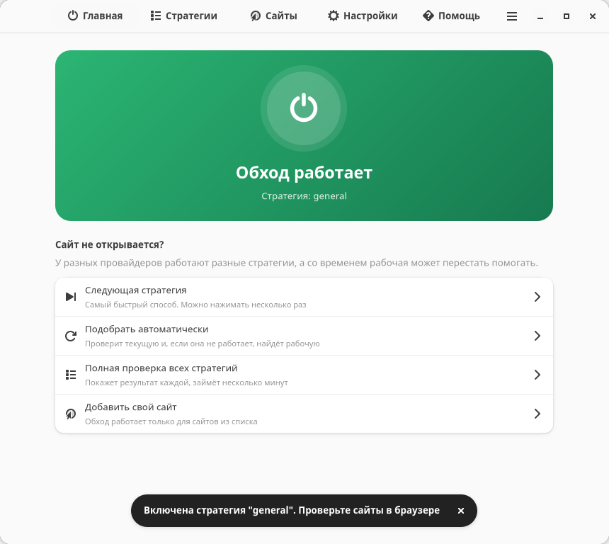

# Zapret Cap

Возвращает доступ к сайтам и сервисам, которые замедляет или блокирует провайдер: YouTube, Discord и другим.
Работает прямо на вашем компьютере с Linux. Это не VPN: сторонние серверы не нужны, а ваш IP-адрес не меняется.

Это перенос [zapret-discord-youtube](https://github.com/Flowseal/zapret-discord-youtube) с Windows на Linux. Здесь те же 22 стратегии, что в оригинале, и те же списки сайтов, а ещё 5 стратегий на приёмах из Android-версии. Работает на движке [zapret2](https://github.com/bol-van/zapret2).

> **Стратегия** - это способ обмануть оборудование провайдера. У разных провайдеров работают разные стратегии, а со временем рабочая может перестать помогать. Поэтому здесь есть проверка, которая сама находит подходящую.



## Установка

Понадобятся Linux с доступом к интернету и пароль администратора. В процессе установка скачает нужные пакеты и подготовит программу, это занимает пару минут.

### Ubuntu, Debian, Linux Mint

Скачайте файл `zapret-cap_..._all.deb` из [последнего релиза](https://github.com/CapptainnCWC/zapret-cap/releases/latest) и откройте его двойным щелчком: система предложит установить приложение. Если этого не произошло, откройте терминал в папке с файлом и выполните:

```bash
sudo apt install ./zapret-cap_*_all.deb
```

### Другие системы: Fedora, Arch, openSUSE и похожие

1. Скачайте этот репозиторий: кнопка **Code → Download ZIP** на его странице. Распакуйте архив, например, в папку «Загрузки».
2. Откройте терминал: обычно **Ctrl+Alt+T**, либо найдите «Терминал» в меню приложений.
3. Перейдите в распакованную папку. Проще всего написать `cd ` с пробелом на конце, перетащить папку мышкой в окно терминала и нажать Enter.
4. Запустите установку:

```bash
bash install.sh
```

Система спросит пароль. При вводе символы не отображаются, это нормально: просто наберите его и нажмите Enter. Папку с архивом после этого можно удалить: программа копируется в `/opt/zapret-cap`. Этот способ работает и на Ubuntu, а заодно кладёт ярлык на рабочий стол.

## Первый запуск

1. Откройте **Zapret Cap** в меню приложений.
2. На вкладке **Главная** нажмите большую круглую кнопку.
3. Выберите **Подобрать**. Система спросит пароль администратора, а приложение само найдёт рабочую стратегию. Это занимает от минуты до нескольких минут.

Готово. Обход работает и будет включаться сам при каждом запуске компьютера. Окно можно закрыть.

Пароль нужен только для действий, которые меняют настройки обхода, и спрашивается один раз за несколько минут. Смотреть состояние и списки можно без него.

Чтобы закрепить приложение на панели, нажмите на его значок правой кнопкой и выберите «Закрепить». Ярлык на рабочем столе включается на вкладке **Настройки**.

### Включите защищённый DNS в браузере

Без этого провайдер может подменять адреса сайтов, и стратегии не помогут.

- **Chrome, Chromium, Яндекс Браузер:** Настройки → Конфиденциальность и безопасность → Безопасность → «Использовать безопасный DNS». Выберите поставщика, например Google или Cloudflare, а не вариант по умолчанию.
- **Firefox:** Настройки → Приватность и защита → «DNS через HTTPS» → «Максимальная защита». В поле поставщика выберите «Другой» и впишите `https://dns.google/dns-query`.

## Если что-то перестало работать

Это нормально: провайдеры меняют настройки, и стратегии устаревают. Откройте приложение, на вкладке **Главная** есть раздел «Сайт не открывается?»:

| Кнопка | Что делает | Когда выбирать |
| :--- | :--- | :--- |
| **Следующая стратегия** | Сразу переключает на другую стратегию | Быстрее всего. Можно нажимать несколько раз, пока сайт не откроется |
| **Подобрать автоматически** | Проверяет текущую стратегию. Если она не работает, перебирает остальные и включает рабочую | Если не хочется проверять вручную |
| **Полная проверка всех стратегий** | Показывает результат каждой стратегии, а лучшую можно включить одной кнопкой | Если первые два пункта не помогли |

То же самое из терминала:

```bash
zapret next
```

```bash
zapret auto
```

После смены стратегии обновите страницу в браузере. Иногда браузер нужно закрыть и открыть заново.

## Как добавить сайт

Обход работает только для сайтов из списка. Если нужный сайт не открывается, откройте вкладку **Сайты**, вставьте адрес и нажмите **Добавить**.

Можно вставить ссылку целиком прямо из браузера: приложение само оставит только нужную часть. Поддомены учитываются автоматически, а кириллические домены преобразуются сами.

Перезапускать ничего не нужно: достаточно обновить страницу.

## Что есть в приложении

| Вкладка | Что там |
| :--- | :--- |
| **Главная** | Включить и выключить обход, следующая стратегия, автоматический подбор |
| **Стратегии** | Проверка стратегий и список всех стратегий с результатами обоих тестов. Нажатие на стратегию сразу включает её |
| **Сайты** | Добавить, найти и убрать сайты |
| **Настройки** | Автозапуск и ярлык, фильтр игр и его порты, режим и список IPSet, активные фейки, проверка обновлений, файл hosts, удаление приложения |
| **Помощь** | Поиск частых проблем: VPN, прокси, другие средства обхода. Там же очистка кэша Discord, настройка защищённого DNS, отчёты о проверках и журнал действий |

### Проверка стратегий

Бывает, что стратегия открывает сайты, но соединение замирает после первых 16-20 КБ: страница начинает грузиться и останавливается, видео не идёт. Поэтому по умолчанию на вкладке **Стратегии** запускаются обе проверки сразу:

- **Открытие сайтов**: Discord, YouTube, Google, Cloudflare по HTTP, TLS 1.2 и TLS 1.3, как в тесте Windows-версии.
- **Замирание на 16-20 КБ**: на серверы разных хостингов отправляются 64 КБ, и проверяется, не обрывается ли передача.

У каждой стратегии видны оба результата отдельно, например «сайты 24/36» и «замирание 2/18»: открылось 24 проверки из 36, а 2 передачи из 18 замерли. Список отсортирован так: сначала стратегии, которые открывают больше сайтов, при равенстве у кого меньше замираний. Итоги сохраняются: если проверить часть стратегий, у остальных останутся прежние результаты.

Проверку можно запустить и по отдельности: «Только сайты» или «Только замирание». **Следующая стратегия** и **Подобрать автоматически** перебирают стратегии в том же порядке.

### Стратегии из Android-версии

В Android-версии без прав root есть свои приёмы ByeDPI, которых нет в стратегиях Windows. Здесь они перенесены на движок `nfqws2` и стоят в списке рядом с остальными:

| Стратегия | Что делает |
| :--- | :--- |
| **general (BYEDPI SPLIT)** | Режет начало соединения на два сегмента сразу после начала имени сайта |
| **general (BYEDPI TLSREC)** | Делит ClientHello на две записи TLS и два сегмента в начале имени сайта |
| **general (BYEDPI DISORDER)** | То же деление записи, а сегменты отправляются в обратном порядке |
| **general (BYEDPI OOB)** | Вставляет в начало имени сайта байт OOB: сервер его отбрасывает, а DPI может принять за часть имени |
| **general (BYEDPI AUTO)** | Для каждого сайта сначала меняет порядок сегментов, при сбросах соединения переходит к разрезу, затем к обманке |

Все, кроме **AUTO**, обходятся без пакетов-обманок, поэтому им не мешают близко расположенные серверы. **TLSREC**, **DISORDER** и **OOB** добавляют в соединение байты, а это возможно только с самого первого пакета, когда имя сайта ещё неизвестно. Поэтому для сайтов из списка они срабатывают со второго соединения к тому же адресу, а в первом остаётся простой разрез. Браузер открывает к сайту много соединений, так что это почти незаметно.

**Фильтр игр** включает обход для игр и других программ на портах выше 1023. Работает только для адресов из IPSet, поэтому обычно нужен ещё режим IPSet «Из списка» или «Все».

**IPSet** определяет, какие IP-адреса обрабатывать: «Никакие», «Из списка» или «Все». Режим «Все» помогает, если сайт не открывается, но сильнее нагружает компьютер.

**Файл hosts** может починить веб-версию Telegram и голосовые каналы Discord.

### Меню в терминале

Всё то же самое есть в терминале, в том числе если окно не запускается: команда `zapret` откроет меню. Ниже перечислены и отдельные команды.

## Частые проблемы

**Пропал интернет или всё стало работать хуже.** Выключите обход большой кнопкой. Если стало лучше, причина в стратегии: попробуйте другую.

**Ни одна стратегия не помогает.**
- На вкладке **Помощь** нажмите **Проверить** и исправьте то, на что указывает приложение.
- Выключите VPN и другие программы для обхода блокировок: вместе они мешают друг другу.
- Проверьте, что включён защищённый DNS в браузере.
- Перезагрузите компьютер и роутер.

**Сайт не открывается, хотя всё остальное работает.** Убедитесь, что сайт есть на вкладке **Сайты**, и добавьте его. Если не помогло, на вкладке **Настройки** включите режим IPSet «Все».

**Сайт, который раньше работал без программы, перестал открываться.** На вкладке **Настройки** выберите режим IPSet «Никакие».

**Discord зависает на подключении или нет звука.** На вкладке **Помощь** очистите кэш Discord. Попробуйте другую стратегию и проверку файла hosts на вкладке **Настройки**.

**Не работает игра.** На вкладке **Настройки** включите фильтр игр и режим IPSet «Из списка» или «Все».

**Приложение пишет, что работает другое средство обхода.** У вас уже установлен zapret, byedpi или что-то похожее. На вкладке **Помощь** его можно остановить и убрать из автозапуска. Файлы при этом остаются на месте, а включить его обратно можно через `systemctl enable --now ИМЯ`.

**Приложение не открывается.** Для окна нужны Python, GTK 4 и libadwaita: повторите установку, она поставит их сама. На очень старых системах их может не быть, тогда пользуйтесь меню в терминале: команда `zapret`.

**Команда `zapret` не найдена.** Откройте новое окно терминала. Если не помогло, повторите установку.

**Где результаты тестов?** На вкладке **Помощь** есть кнопка **Отчёты о проверке стратегий**. Приложите свежий файл и текст из **Журнала действий**, если просите о помощи.

## Обновление и удаление

**Обновление.** Когда выходит новая версия, приложение показывает сверху кнопку **Обновить**: одно нажатие скачивает релиз с GitHub и ставит его, а окно открывается заново уже в новой версии. Проверить обновления можно и сами: кнопка **Проверить обновления** внизу главной вкладки проверяет и приложение, и стратегии Flowseal. Приложение обновляется тем же способом, каким было установлено: пакетом `.deb` или через `install.sh`. Добавленные сайты и настройки сохраняются. Без окна обновление запускает команда `sudo zapret upgrade`.

**Удаление.** На вкладке **Настройки** нажмите **Удалить**. Без окна это делает команда:

```bash
sudo /opt/zapret-cap/uninstall.sh
```

## Все команды

```text
zapret                      меню в терминале
zapret gui                  окно приложения
zapret status               что сейчас работает
zapret list                 стратегии с результатами последнего теста
zapret use ALT11            включить стратегию (имя или номер из списка)
zapret next                 следующая стратегия
zapret auto                 проверить и подобрать рабочую
zapret start                включить последнюю стратегию
zapret stop                 выключить обход
zapret autostart on|off     автозапуск

zapret test                 тест с выбором в диалоге
zapret test full all        оба теста всех стратегий: сайты и замирание
zapret test standard all    только открытие сайтов
zapret test dpi 1,3,5-7     только замирание, у выбранных стратегий
                            --apply-best включает лучшую без вопроса

zapret add ДОМЕН...         добавить сайт
zapret remove ДОМЕН...      убрать сайт
zapret domains              список сайтов

zapret game off|all|tcp|udp     фильтр игр
zapret game-ports tcp 1024-65535
zapret ipset none|loaded|any    режим IPSet
zapret ipset update             обновить список адресов
zapret fakes                    заменить активные фейки
zapret hosts                    обновить файл hosts
zapret update-check [on|off]    проверка новых стратегий Flowseal
zapret upgrade [--check]        обновить само приложение из релизов GitHub
zapret diag                     диагностика
```

## Для тех, кто хочет разобраться

| Что | Где |
| :--- | :--- |
| Стратегии | `strategies/*.conf`. Свою можно добавить новым файлом: она появится в списке и попадёт в тесты |
| Списки сайтов | `lists/list-general.txt` и остальные файлы в `lists/` |
| Сайты для теста | `utils/targets.txt` |
| Как стратегии переведены с Windows | [docs/PORTING.md](docs/PORTING.md) |
| Движок zapret2 без изменений | `core/`, документация в `core/docs/manual.md` |
| Окно приложения | `gui/`, значок и ярлык в `data/`. Окно только вызывает команды утилиты |
| Сборка пакета .deb | `packaging/build-deb.sh` |
| Проверка без прав администратора | `tests/sandbox-test.sh`, окно: `tests/gui-test.sh`, установка: `tests/install-test.sh` |

## Благодарности и лицензия

- [bol-van](https://github.com/bol-van) - автор [zapret](https://github.com/bol-van/zapret) и [zapret2](https://github.com/bol-van/zapret2)
- [Flowseal](https://github.com/Flowseal) - автор [zapret-discord-youtube](https://github.com/Flowseal/zapret-discord-youtube): стратегии, списки и фейки
- [hyperion-cs](https://github.com/hyperion-cs/dpi-checkers) - набор целей для DPI-теста

Лицензия MIT, см. [LICENSE.txt](LICENSE.txt).
